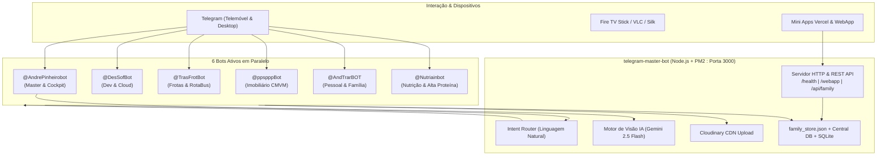

# Relatório Executivo: Unificação de Sistemas e Valências Atuais

> [!NOTE]
> **Data:** 08 de Novembro de 2026  
> **Autor:** Antigravity AI Pair Programmer & André Pinheiro  
> **Estado:** Em Produção (PM2 Online, Render Blueprint Atualizado, GitHub Sincronizado)

---

## 1. Resumo do Trabalho Realizado

Nesta sessão foram consolidadas três frentes operacionais críticas do ecossistema de software:

1. **Unificação Total dos Projetos Telegram:**
   * Fusão dos projetos dispersos (`telegram-multi-bot` e `telegram-master-bot`) numa única arquitetura centralizada: [`telegram-master-bot`](file:///c:/Users/Surface_Dpc/Desktop/projectos/telegram-master-bot).
   * Neutralização e arquivamento do projeto antigo em [`_archive_telegram-multi-bot`](file:///c:/Users/Surface_Dpc/Desktop/projectos/_archive_telegram-multi-bot) com credenciais desativadas (`.env.disabled`) para garantir **zero conflitos de polling** no Telegram e zero colisões de portas TCP.
   * Todos os 5 bots Telegram a correr em paralelo num único processo Node.js sob gestão do **PM2** com consumo otimizado de apenas ~72MB de RAM.

2. **MatchPro & Streaming de TV (Silk Browser / VLC):**
   * Diagnóstico e resolução do estrangulamento de CPU no Silk Browser do Fire TV Stick: substituição de filtros SVG convolucionais por aceleração gráfica nativa e desativação de Web Workers pesados no HLS.
   * Criação de listas de reprodução M3U segregadas por categoria com buffer otimizado de 2000ms (`#EXTVLCOPT:network-caching=2000`) e User-Agent de emulação para contornar bloqueios de CDN.
   * Criação e validação da lista dedicada para **Canais Infantis & Crianças** (11 canais portugueses em alta definição).
   * Disponibilização de atalhos e painel interativo diretamente no Ambiente de Trabalho ([`LISTAS_VLC_MATCHPRO.html`](file:///C:/Users/Surface_Dpc/Desktop/LISTAS_VLC_MATCHPRO.html) e [`LISTAS_VLC_MATCHPRO.txt`](file:///C:/Users/Surface_Dpc/Desktop/LISTAS_VLC_MATCHPRO.txt)).

3. **Visão Multimodal com Inteligência Artificial e CDN:**
   * Integração dos motores **Gemini Multimodal Vision** e **Cloudinary CDN** em todos os bots para análise instantânea de fotografias enviadas pelo utilizador.

---

## 2. Mapa de Arquitetura Unificada



---

## 3. Valências dos 5 Bots Telegram

Cada bot possui autonomia para responder a comandos diretos, botões inline e eventos de fotografia com IA:

### 👑 1. Master Cockpit (`@AndrePinheirobot`)
* **Papel:** Ponto de entrada central de todo o ecossistema pessoal e profissional.
* **Roteador de Intenções por Linguagem Natural:** Compreende frases em texto livre (ex: *"preciso de comprar maçãs"*, *"faz uma rota porto para braga"*, *"quanto vale um t3 em amarante"*, *"mostra os meus repositórios"*) e redireciona a execução em memória para o worker especialista sem erros.
* **Teclados Dinâmicos de Mini Apps:** Botões diretos para abrir o Cockpit WebApp da Família, RotaBus VIP, MatchPro e Pladur-Pro.
* **Comandos Principais:** `/start`, `/menu`, `/apps`, `/briefing`, `/compras`, `/tarefas`, `/carolina`, `/rota`, `/tacografo`, `/projetos`, `/avaliacao`.

### 💻 2. Worker Dev & Cloud (`@DesSofBot`)
* **Papel:** Engenharia de software autónoma, gestão de repositórios e compilações.
* **Valências Ativas:**
  * Consulta à **API do GitHub** com listagem dos repositórios mais recentes.
  * Criação automática de novos repositórios GitHub (`/criar_app <nome>`).
  * Catálogo e download de compilações **Android (APKs)** geradas (RotaBus APK).
  * Inspeção e sincronização de Mini Apps alojadas no Vercel.

### 🚌 3. Worker Frotas & Tacógrafo (`@TrasFrotBot`)
* **Papel:** Gestão de pesados, transporte de equipas desportivas e mobilidade VIP.
* **Valências Ativas:**
  * **Cálculo de Rotas HGV (OpenRouteService):** Traçados otimizados para veículos pesados com controlo de sinuosidade (evitar curvas apertadas para passageiros/atletas).
  * **Auditoria de Tacógrafo Digital (Regulamento CE 561/2006):**
    * Limites de condução contínua (máximo 4h30 com 45m de pausa).
    * Limites diários (9h / 10h) e descansos obrigatórios (11h / 9h reduzido).
  * **Verificação de Gabaritos 3D:** Altura máxima legal (4.00m), largura (2.55m) e comprimento por eixos.
  * Integração direta com a aplicação web e APK **RotaBus**.

### 🏠 4. Worker Imobiliário CMVM (`@ppspppBot`)
* **Papel:** Avaliação de património imobiliário e prospeção de mercado.
* **Valências Ativas:**
  * Avaliação paramétrica por m² conforme normas da **CMVM**.
  * Base de dados de preços de referência por zona: **Amarante**, **Porto**, **Braga**, **Felgueiras**, **Penafiel**, **Marco de Canaveses** e **Vila Real**.
  * Ajustes por tipologia (T1 a T5+), estado de conservação (novo, bom, usado, ruína) e cálculo de margem de negociação bancária.

### 👔 5. Worker Pessoal & Família (`@AndTrarBOT`)
* **Papel:** Produtividade doméstica, nutrição, ergonomia e acompanhamento familiar.
* **Valências Ativas:**
  * **Lista de Compras Sincronizada:** Adicionar, marcar como comprado, remover e limpar concluídos (sincronizado em tempo real com a Mini App Família).
  * **Tarefas da Casa & Pessoais:** Gestão de pendências com atribuição de responsáveis.
  * **Registo da Carolina:** Histórico escolar, faltas justificadas, consultas pediátricas e atividades extracurriculares.
  * **Nutrição de Alta Proteína (Meta: 160g):**
    * Registo de refeições (`/proteina 54 : Lombo de porco air-fryer`) com cálculo percentual em relação à meta diária de 160g.
    * Plano alimentar de referência com cálculo de macronutrientes.
  * **Ergonomia & Saúde Ocupacional:** Diretrizes de ângulo lombar (105º-110º), alinhamento cervical e pausas ativas a cada 2 horas.
  * **Briefing Diário com IA:** Resumo matinal que cruza tarefas pendentes, compras urgentes e notas, gerando uma mensagem de foco motivacional com Gemini AI.

### 🥗 6. Worker Nutrição & Alta Proteína (`@Nutriainbot`)
* **Papel:** Especialista dedicado em nutrição desportiva, hipertrofia, dieta de alta proteína e hidratação.
* **Valências Ativas:**
  * **Meta Proteica Diária (160g):** Barra de progresso gráfica no chat (`[████████░░] 75%`), cálculo de défice/superávit proteico e histórico de refeições.
  * **Registo Rápido de Refeições (`/proteina <gramas> : <prato>`):** Atribuição direta com estimativa de calorias e persistência atómica no `family_store.json`.
  * **Registo de Hidratação (`/agua <ml>`):** Controlo da meta diária de 2.5L com botões rápidos (+250ml / +500ml).
  * **Controlo de Creatina (`/creatina`):** Marcação diária da toma de 5g para saturação muscular contínua.
  * **Análise Visual de Pratos por IA Multimodal (Gemini):** O utilizador envia uma fotografia do prato/refeição e a IA identifica os ingredientes e estima gramas de proteína, hidratos, lípidos e Kcal.
  * **Receitas de Alta Proteína:** Geração instantânea de receitas rápidas com ingredientes disponíveis em casa (lombo em air-fryer, peito de peru, ovos, cottage Milbona).
  * **Comandos Principais:** `/plano`, `/hoje`, `/proteina`, `/agua`, `/creatina`, `/macros`.

---

## 4. Capacidades de Inteligência Artificial & Multimodalidade

| Recurso | Motor | Descrição Operacional |
| :--- | :--- | :--- |
| **Visão Multimodal** | Google Gemini 2.5 Flash *(fallback 2.0/1.5)* | Recebe fotografias enviadas para qualquer um dos 5 bots. Classifica e analisa refeições (Kcal e macros), documentos, recibos de despesa, plantas de pladur e discos de tacógrafo. |
| **CDN de Imagens** | Cloudinary API | Faz upload automático das imagens recebidas e fornece link permanente seguro (`https://res.cloudinary.com/...`). |
| **Inferência Rápida** | Groq LPU (GPT-OSS / Llama 3) | Processamento ultrarrápido com baixa latência para respostas instantâneas. |
| **Geocoding & Rotas** | OpenRouteService API | Tradução de localidades portuguesas para coordenadas geográficas e cálculo de distâncias reais em estrada. |
| **Chat Limpo (Anti-Spam)** | Telegraf Middleware | Apaga automaticamente as mensagens de comando enviadas pelo utilizador para manter as janelas de chat organizadas. |

---

## 5. Mini Apps Vercel & Cockpits Conectados

O ecossistema está interligado a **9 aplicações web em produção no Vercel**:

1. 🏡 **Família (Gestão & Carolina):** `https://gestao-familiar-webapp.vercel.app`
2. 🚌 **RotaBus (Frotas VIP & GPS):** `https://smooth-bus-routes.vercel.app` *(APK nativo disponível)*
3. ⚽ **MatchPro (Streaming & Scout):** `https://matchpro-alpha.vercel.app`
4. 🏗️ **Pladur-Pro (Engenharia 3D):** `https://pladur-pro.vercel.app`
5. 🚛 **AppFrota (Logística):** `https://appfrota-ten.vercel.app`
6. 🏰 **Casa de Bonecas 3D:** `https://casadebonecas-3d.vercel.app`
7. 🏠 **ImmoEval (Avaliação Imobiliária):** `https://pesquisa-imobiliario.vercel.app`
8. 💻 **Scaffold Bot:** `https://teste-scaffold-bot.vercel.app`
9. 🔤 **Letras e Números 123:** `https://letras-e-numeros-123.vercel.app`

---

## 6. MatchPro: Listas VLC & Performance de TV

Para o ecossistema de streaming desportivo e televisivo:

* **Otimizações do Silk Browser (Fire TV Stick):**
  * Eliminação de filtros convolucionais SVG pesados (`feConvolveMatrix`) que provocavam 100% de ocupação do CPU.
  * Configuração do `Hls.js` sem Web Workers para evitar bloqueios de thread no motor Chromium do Stick.
  * Modo de baixa especificação (`.tv-mode.low-spec-mode`) sem desfoques CSS nem animações contínuas.
* **Listas M3U Curadas em Produção:**
  * **👶 Crianças & Infantil (11 canais):** `https://matchpro-alpha.vercel.app/criancas.m3u` *(Canal Panda, Panda Kids, Disney, Disney Jr, Cartoon Network, Cartoonito, Nickelodeon, Nick Jr, SIC K, Baby TV, Biggs)*
  * **⭐ Top 16 Principais (Troca Rápida):** `https://matchpro-alpha.vercel.app/top.m3u`
  * **⚽ Sport TV (39 canais):** `https://matchpro-alpha.vercel.app/sporttv.m3u`
  * **🏆 DAZN / Eleven (23 canais):** `https://matchpro-alpha.vercel.app/dazn.m3u`
  * **🇵🇹 Clubes & Nacional (10 canais):** `https://matchpro-alpha.vercel.app/clubes.m3u`
  * **🚴 Eurosport (9 canais):** `https://matchpro-alpha.vercel.app/eurosport.m3u`
  * **🌐 Grelha Completa (92 canais):** `https://matchpro-alpha.vercel.app/playlist.m3u`

---

## 7. Estado do Sistema & Manutenção

```bash
# Ver estado dos serviços
pm2 status

# Ver registos em direto
pm2 logs telegram-master-bot

# Reiniciar o serviço unificado
npm run pm2:restart

# Teste de saúde local (HTTP)
curl http://localhost:3000/health
```

> [!TIP]
> **Segurança de Dados:** O projeto antigo encontra-se arquivado em `_archive_telegram-multi-bot` com credenciais desativadas. O projeto principal `telegram-master-bot` possui todo o histórico consolidado e com commit gravado no GitHub.
