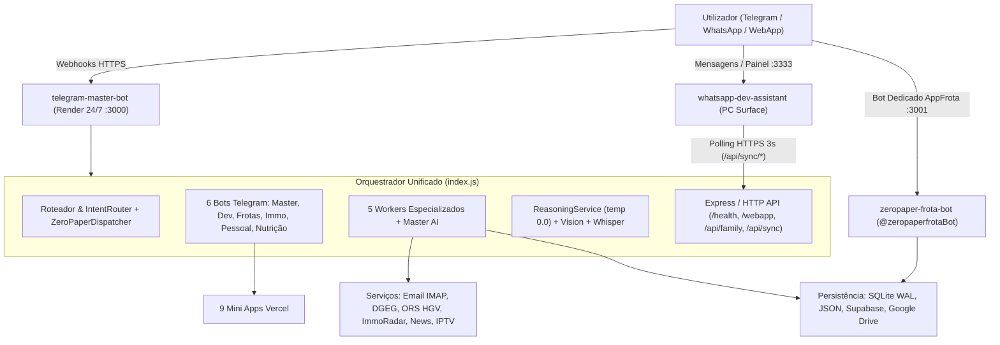

# Documento Mestre de Arquitetura e Operação do Sistema (`telegram-master-bot`)

> **Documento Canónico do Ecossistema Unificado**  
> **Serviço Principal (Nuvem 24/7):** [`https://telegram-master-bot-0h2h.onrender.com`](https://telegram-master-bot-0h2h.onrender.com)  
> **Runtime:** Node.js ESM (`>=18.0.0`, Docker `node:20-alpine` no Render)  
> **Fuso Horário Operacional:** `Europe/Lisbon`

---

## 1. Visão Geral do Ecossistema

O sistema é composto por um **orquestrador central em produção 24/7 no Render** (`telegram-master-bot`) que agrega **6 bots especializados do Telegram**, um **motor de IA determinístico (`temperature: 0.0`)**, APIs oficiais e em tempo real, uma **API REST familiar**, e integrações bidirecionais com **dois serviços companheiros** (`zeropaper-frota-bot` e `whatsapp-dev-assistant`) e **9 Mini Apps Web alojadas no Vercel**.



---

## 2. Arquitetura de Execução Única e Sem Conflitos

Para evitar erros **`409 Conflict: terminated by setWebhook request`** na API do Telegram e duplicação de estado entre o PC local e a nuvem:

1. **Instância Autoritativa Única na Nuvem (`Render`)**:
   - Quando `RENDER_EXTERNAL_URL` ou `WEBHOOK_BASE_URL` está definido (e `USE_POLLING` não está ativo), o [`index.js`](file:///c:/Users/Surface_Dpc/Desktop/projectos/telegram-master-bot/index.js) regista webhooks individuais por bot (`/webhook/master`, `/webhook/dev`, `/webhook/frotas`, `/webhook/immo`, `/webhook/pessoal`, `/webhook/nutricao`).
   - Apenas em execução explicitamente configurada para polling local (`launchSingleBot`) é invocado `deleteWebhook`.
2. **Ligação Segura ao PC Local (`pcRemoteBridge` + `pc-worker.js`)**:
   - Em vez de executar uma segunda instância dos bots do Telegram no PC, o PC Surface corre apenas o agente leve [`scripts/pc-worker.js`](file:///c:/Users/Surface_Dpc/Desktop/projectos/whatsapp-dev-assistant/scripts/pc-worker.js) (`npm run worker`), que consulta o Render via HTTPS (`/api/sync/*`) a cada **3 segundos** (`POLL_INTERVAL_MS = 3000`) autenticado por `x-sync-token` (`SYNC_SECRET_TOKEN`).
   - No lado da nuvem, [`src/services/pcRemoteBridge.js`](file:///c:/Users/Surface_Dpc/Desktop/projectos/telegram-master-bot/src/services/pcRemoteBridge.js) gere o *heartbeat* (janela online de 60 segundos) e a fila de ordens remotas com timeout de 25 segundos (`executeOnPc`).
3. **Rotinas Automáticas e Keep-Alive no Orquestrador**:
   - **Arranque:** Restauro de estado a partir do Google Drive antes de servir pedidos.
   - **Auto-Sync Google Drive:** Backup automático a cada **15 minutos**.
   - **Keep-Alive Render:** Ping periódico de **10 em 10 minutos** ao URL externo do serviço.
   - **Radar Imobiliário (`iniciarAgendadorRadar`):** Varredura automática em Amarante a cada **4 horas** (entre as 08h e as 22h) e relatório diário às **08:30**.
   - **Briefing Noticioso Europa/PT:** Disparo diário automático às **08:00**.
   - **Lembretes Proativos:** Ciclo de verificação a cada **15 segundos**.
4. **Execução Local Opcional com PM2 (`ecosystem.config.cjs`)**:
   - Configurado para instância única (`instances: 1`, `exec_mode: 'fork'`, `max_memory_restart: '350M'`, logs em `./logs/bot-out.log` e `./logs/bot-error.log`).

---

## 3. Catálogo de Bots e Serviços do Ecossistema

### 3.1 Os 6 Bots Unificados no `telegram-master-bot`

Todos os bots são instanciados simultaneamente em `botInstances` dentro de [`index.js`](file:///c:/Users/Surface_Dpc/Desktop/projectos/telegram-master-bot/index.js):

| Bot | Handle Telegram | Endpoint Webhook | Worker / Destino Principal | Especialidade |
| :--- | :--- | :--- | :--- | :--- |
| **Master** | `@AndrePinheirobot` | `/webhook/master` | Orquestrador + `workerTag: 'master'` | Triagem universal, briefings globais e fallback de IA |
| **Dev** | `@DesSofBot` | `/webhook/dev` | [`worker_dev.js`](file:///c:/Users/Surface_Dpc/Desktop/projectos/telegram-master-bot/src/workers/worker_dev.js) | GitHub, Vercel Mini Apps, APKs Android, PC remoto e código |
| **Frotas** | `@TrasFrotBot` | `/webhook/frotas` | [`worker_frotas.js`](file:///c:/Users/Surface_Dpc/Desktop/projectos/telegram-master-bot/src/workers/worker_frotas.js) | AppFrota/ZeroPaper, rotas pesados (`driving-hgv`), tacógrafo CE 561/2006 |
| **Immo** | `@ppspppBot` | `/webhook/immo` | [`worker_immo.js`](file:///c:/Users/Surface_Dpc/Desktop/projectos/telegram-master-bot/src/workers/worker_immo.js) | Radar de moradias novas, portais imobiliários, avaliação pericial CMVM |
| **Pessoal** | `@AndTrarBOT` | `/webhook/pessoal` | [`worker_geral.js`](file:///c:/Users/Surface_Dpc/Desktop/projectos/telegram-master-bot/src/workers/worker_geral.js) | Emails IMAP, combustíveis DGEG, trânsito, notícias, IPTV, família e lembretes |
| **Nutrição** | `@Nutriainbot` | `/webhook/nutricao` | [`worker_nutricao.js`](file:///c:/Users/Surface_Dpc/Desktop/projectos/telegram-master-bot/src/workers/worker_nutricao.js) | Meta de 160g proteína/dia, 2.5L água, 5g creatina e análise de macros |

### 3.2 Serviços Companheiros

| Projeto | Entrada / Porta | Função no Ecossistema |
| :--- | :--- | :--- |
| **ZeroPaperFrota Bot** ([`server.js`](file:///c:/Users/Surface_Dpc/Desktop/projectos/zeropaper-frota-bot/server.js)) | Express `:3001` (`@zeropaperfrotaBot`) | Bot operacional dedicado à frota com persistência direta no Supabase, confirmação em 2 passos (`confirmation.js`), idempotência (`idempotency.js`) e gestão de ações pendentes (`pendingActions.js`). |
| **WhatsApp Dev Assistant** ([`src/index.js`](file:///c:/Users/Surface_Dpc/Desktop/projectos/whatsapp-dev-assistant/src/index.js)) | Painel Web `:3333` + Baileys | Cliente WhatsApp no PC com integração Antigravity CLI, compilação Android/Gradle (`.apk`), controlo de sistema e worker ponte [`scripts/pc-worker.js`](file:///c:/Users/Surface_Dpc/Desktop/projectos/whatsapp-dev-assistant/scripts/pc-worker.js) ligado ao Render. |

---

## 4. Pipeline de Roteamento, Classificação e Formatação

### 4.1 Ordem de Decisão em `rotear(ctx, text)`
1. Comandos globais rápidos (`/reset`, padrões de estado/resumo/macros, notícias Europa/Portugal).
2. **`tryAutoDispatch`** ([`zeroPaperDispatcher.js`](file:///c:/Users/Surface_Dpc/Desktop/projectos/telegram-master-bot/src/services/zeroPaperDispatcher.js)): analisa linguagem natural em `temperature: 0.0` (`response_mime_type: 'application/json'`) via Gemini (`gemini-flash-lite-latest`, `gemini-flash-latest`) com fallback Groq para os domínios:
   - `APPFROTA`: `KM`, `ANOMALIA`, `HIGIENIZACAO`, `CHECKLIST`, `SERVICO`, `STOCK`, `CONSULTA`
   - `PESSOAL`: `COMPRAS`, `TAREFA`
   - `LEMBRETE`
   - `PC_REMOTE`: `PC`
   - `GERAL`: `CONVERSA`
3. Comandos explícitos de barra (`/emails`, `/combustiveis`, `/moradias_novas`, `/avaliacao`, `/rota`, `/tacografo`, `/proteina`, etc.).
4. **`detectIntent`** ([`src/router/intentRouter.js`](file:///c:/Users/Surface_Dpc/Desktop/projectos/telegram-master-bot/src/router/intentRouter.js)): ordem determinística de prioridade `FROTAS` → `IMMO` → `DEV` → `TV` → `GERAL` → `NUTRICAO`, com fallback padrão `'GERAL'`.
5. Fallback final para `askAgent` com perfil `workerTag: 'master'`.

### 4.2 Resiliência de Entrega e Sanitização Markdown
- [`src/utils/markdownSanitizer.js`](file:///c:/Users/Surface_Dpc/Desktop/projectos/telegram-master-bot/src/utils/markdownSanitizer.js): `sanitizeTelegramMarkdown` protege blocos de código, código inline e links Markdown com tokens temporários `§§...§§`, escapa underscores internos de identificadores `snake_case` e balanceia `*` e `_` desemparelhados.
- `sendReply` em [`index.js`](file:///c:/Users/Surface_Dpc/Desktop/projectos/telegram-master-bot/index.js): divide mensagens acima de `maxLen = 4000` caracteres e, se o Telegram rejeitar o *parse* Markdown, reenvia automaticamente em texto simples.
- [`src/utils/resilience.js`](file:///c:/Users/Surface_Dpc/Desktop/projectos/telegram-master-bot/src/utils/resilience.js): disponibiliza `withTimeout`, `safeExecute` e `withTypingHeartbeat`.

---

## 5. Inteligência Artificial Determinística (`temperature: 0.0`) e Multimodal

1. **Motor de Raciocínio (`src/services/reasoningService.js`)**:
   - Todas as chamadas operam com **`temperature: 0.0`** e política rigorosa **anti-alucinação**, instruindo os modelos a nunca inventar preços, stocks, distâncias, emails ou factos sem base real ou ferramenta verificada.
   - Prompts especializados e enquadramento regulatório por persona:
     - `master` / `pessoal` / `dev`: referência a conformidade **EU AI Act (UE 2024/1689)** e **RGPD (UE 2016/679)**.
     - `frotas`: **Regulamento (CE) n.º 561/2006** (tempos de condução e repouso).
     - `immo`: **Regulamento CMVM n.º 2/2015** (peritagem e avaliação imobiliária).
     - `nutricao`: referenciais **EFSA / ISSN**.
   - Cascata de modelos configurada: **Google Gemini** → **Groq LPU** (`GROQ_MODEL` ou fallback `'qwen/qwen3.8-27b'`) → **OpenRouter**.
2. **Memória Conversacional (`src/shared/conversationMemory.js`)**:
   - Guarda até **`MAX_TURNS = 12`** turnos por sessão com validade **`SESSION_TTL_MS = 3h`**, persistindo em `./data/conversas_historico.json` com sincronização para o Google Drive.
3. **Visão e Voz**:
   - **Imagens / Documentos (`src/shared/multimodalVision.js`)**: análise visual com Gemini (`gemini-flash-lite-latest`, `gemini-flash-latest`, `temperature: 0.0`, timeout `10s`) e alojamento via [`src/shared/cloudinaryCdn.js`](file:///c:/Users/Surface_Dpc/Desktop/projectos/telegram-master-bot/src/shared/cloudinaryCdn.js).
   - **Mensagens de Voz (`src/shared/whisperAudio.js`)**: transcrição automática via **Groq Whisper LPU** para texto encaminhado ao mesmo pipeline de roteamento e ZeroPaper.

---

## 6. Referência de Comandos e Funcionalidades por Domínio

### 6.1 Assistente Pessoal, Email, Combustíveis & Família (`worker_geral.js`)
- **Email Gmail IMAP ([`emailService.js`](file:///c:/Users/Surface_Dpc/Desktop/projectos/telegram-master-bot/src/services/emailService.js)):**
  - `/emails` — Lista os emails recentes reais via `ImapFlow` (`imap.gmail.com:993`, `EMAIL_SECURE !== 'false'`).
  - `/ler_email <N|assunto>` — Lê o corpo completo (via `mailparser`) e gera resumo executivo com IA determinística.
  - `/email_status` — Testa a ligação IMAP ativa (apresentando endereço mascarado, ex.: `an***o@gmail.com`).
  - `/briefing` — Gera o briefing executivo consolidado do dia (emails, notícias, agenda/lembretes, estado geral).
- **Combustíveis Oficiais DGEG ([`combustiveisService.js`](file:///c:/Users/Surface_Dpc/Desktop/projectos/telegram-master-bot/src/services/combustiveisService.js)):**
  - `/combustiveis [concelho]` · `/gasoleo [concelho]` · `/gasolina [concelho]` — Consulta a API pública oficial da DGEG (`precoscombustiveis.dgeg.gov.pt`, Distrito do Porto `idDistrito=13`) para **Gasóleo Simples (`2101`)** e **Gasolina 95 Simples (`3201`)**.
  - Concelhos mapeados: `amarante`/`lixa` (`181`), `baiao` (`183`), `felgueiras` (`185`), `marco` (`187`), `paredes` (`189`), `penafiel` (`191`), `porto` (`192`), `vilareal` (`254`).
- **Utilidades, Notícias, Trânsito & TV:**
  - `/transito` — Informação de trânsito (ex.: eixo A4 / Túnel do Marão).
  - `/pesquisa <termo>` · `/farmacias` — Pesquisa web ao vivo via DuckDuckGo HTML ([`webSearch.js`](file:///c:/Users/Surface_Dpc/Desktop/projectos/telegram-master-bot/src/shared/webSearch.js)).
  - `/tv [canal]` — Pesquisa na lista de **776 canais PT** e playlists IPTV ([`tvService.js`](file:///c:/Users/Surface_Dpc/Desktop/projectos/telegram-master-bot/src/services/tvService.js)).
  - `/ergonomia` · `/nutricao` — Orientações rápidas de postura e nutrição.
- **Gestão Familiar & Lembretes ([`familyDb.js`](file:///c:/Users/Surface_Dpc/Desktop/projectos/telegram-master-bot/src/shared/familyDb.js)):**
  - `/compras` · `/tarefas` · `/carolina` · `/notas` · `/lembrete` — CRUD em conversa sincronizado com o gestor web familiar e lembretes proativos.

### 6.2 Imobiliário & Avaliação Pericial CMVM (`worker_immo.js`)
- `/moradias_novas` — Pesquisa ao vivo nas plataformas imobiliárias (Idealista, Imovirtual, RE/MAX, ERA via DuckDuckGo HTML em [`immoRadarService.js`](file:///c:/Users/Surface_Dpc/Desktop/projectos/telegram-master-bot/src/services/immoRadarService.js)) combinada com a base SQLite local e catálogo de portais.
- `/radar` — Executa varredura ativa em Amarante (`executarVarreduraAmarante`) e atualiza [`./data/imoveis_amarante.db`](file:///c:/Users/Surface_Dpc/Desktop/projectos/telegram-master-bot/data/imoveis_amarante.db).
- `/relatorio` · `/relatorio_imoveis` — Relatório consolidado dos imóveis captados pelo radar.
- `/sites` · `/sites_immo` — Lista os **12 portais e agências locais** catalogados em [`immoSitesCatalog.js`](file:///c:/Users/Surface_Dpc/Desktop/projectos/telegram-master-bot/src/shared/immoSitesCatalog.js).
- `/alertas` · `/alertas_immo` — Estado dos alertas automáticos (ciclo de 4h e resumo às 08:30).
- `/avaliacao <área> <zona> <tipologia> <estado> [terreno_m2] [CE]` · `/immo` — Avaliação pericial CMVM ([`immoCmvmService.js`](file:///c:/Users/Surface_Dpc/Desktop/projectos/telegram-master-bot/src/services/immoCmvmService.js)):
  - **Zonas Base Amarante:** Amarante Centro (`1.350 €/m²`), Coroa Periférica (`1.180 €/m²`), Zona Limítrofe (`1.120 €/m²`).
  - **Terreno por Escalões:** `35 €/m²` (≤500 m²), `8 €/m²` (501–2000 m²), `2 €/m²` (>2000 m²).
  - Ajustes por classe energética (CAPEX/bónus), estado de conservação e penalização de `-25%` por ausência de licença de utilização.

### 6.3 Frotas, Rotas HGV & Tacógrafo (`worker_frotas.js`)
- `/frota` (`/frotas`, `/veiculos`, `/viaturas`) — Relatório em tempo real das viaturas a partir do Supabase ([`appFrotaService.js`](file:///c:/Users/Surface_Dpc/Desktop/projectos/telegram-master-bot/src/services/appFrotaService.js), cache de 5 min em memória).
- `/rota <ORIGEM> para <DESTINO>` — Cálculo rodoviário de pesados com perfil **`driving-hgv`** via OpenRouteService (`ORS_API_KEY`) e ligação à app RotaBus.
- `/tacografo [horas]` — Verificação legal segundo o **Regulamento (CE) n.º 561/2006** (pausas obrigatórias após 4h30 de condução contínua / fracionamento 15+30 min).
- **Ingestão por Voz ou Texto Natural (`tryAutoDispatch`):** ex.: *"Turno 39-HZ-66 com 155.300 km"*, *"Luz do óleo acesa na carrinha 55-TN-89"*, *"Carrinha 01-AA-01 lavada e desinfetada"*, *"Checklist da 39-HZ-66 ok"*.

### 6.4 Engenharia DevOps & PC Remoto (`worker_dev.js`)
- `/projetos` (`/github`, `/repos`) — Lista repositórios via Octokit (`GITHUB_TOKEN`, `GITHUB_OWNER`).
- `/criar_app <especificação>` — Apoio à criação/arranque de novas aplicações via integração GitHub.
- `/apps` (`/links`, `/catalogo`, `/catalogo_apps`, `/vercel`) — Apresenta o catálogo completo das 9 Mini Apps Vercel.
- `/apks` (`/download_apk`, `/android`) — Fornece links de download Android (ex.: `rotabus.apk`).
- `/pc` (ou frases como *"estado do pc"* / *"memória do pc"*) e `/print` — Executa diagnóstico/comandos no PC Surface em tempo real via [`pcRemoteBridge.js`](file:///c:/Users/Surface_Dpc/Desktop/projectos/telegram-master-bot/src/services/pcRemoteBridge.js).
- `/compilar <projeto>` — Dispara compilação remota via bridge para o `whatsapp-dev-assistant` (`androidService` / `universalProjectService`).
- Linguagem natural de engenharia / código (`handleCode` / `/agy`) via `askAgent` (`workerTag: 'dev'`).

### 6.5 Nutrição & Performance (`worker_nutricao.js`)
- Meta diária configurada: **160g proteína**, **2.5L água (2500ml)** e **5g creatina monoidratada**.
- `/plano` (`/dieta`, `/menu_dieta`) — Plano diário estruturado de refeições ricas em proteína.
- `/hoje` (`/macros`, `/resumo`, `/status`) — Progresso diário com barras visuais (proteína, água e estado da creatina).
- `/proteina <gramas> : <refeição>` (ou padrão rápido como `45g de frango`) — Regista ingestão proteica até 200g por entrada.
- `/agua <ml>` — Regista consumo de água (padrão `250ml`).
- `/creatina` — Regista toma diária de 5g.
- Diálogo livre com contexto em tempo real sobre os macros já consumidos no dia.

---

## 7. Mini Apps Vercel (`appsCatalog.js`) e API HTTP (`index.js` + `familyRoutes.js`)

### 7.1 Catálogo das 9 Mini Apps Web (`VERCEL_APPS`)

| Aplicação | Finalidade | URL Oficial |
| :--- | :--- | :--- |
| **Gestão Familiar & Carolina** | Compras, tarefas, registos da bebé e notas | `https://gestao-familiar-webapp.vercel.app` |
| **RotaBus (Pesados & Conforto VIP)** | Apoio rodoviário a pesados (+ `rotabus.apk`) | `https://smooth-bus-routes.vercel.app` |
| **MatchPro** | Tática, futebol e jogos | `https://matchpro-alpha.vercel.app` |
| **Pladur-Pro** | Engenharia e cálculo 3D de tetos/divisórias | `https://pladur-pro.vercel.app` |
| **AppFrota** | Painel web ZeroPaperFrota (viaturas, KM, anomalias) | `https://appfrota-ten.vercel.app` |
| **Casa de Bonecas 3D** | Aplicação interativa 3D | `https://casadebonecas-3d.vercel.app` |
| **ImmoEval** | Avaliação imobiliária web | `https://pesquisa-imobiliario.vercel.app` |
| **Last War Tactics** | Guia tático e calculadora | `https://last-war-tactics.vercel.app` |
| **Scaffold Bot Preview** | Protótipo de bot / scaffold | `https://teste-scaffold-bot.vercel.app` |

### 7.2 Endpoints HTTP do Orquestrador (`PORT=3000`)
- **Monitorização e Páginas:** `GET /`, `GET /health`, `GET /webapp`, `GET /api/apps`, `GET /portugal.m3u`.
- **Webhooks Telegram:** `POST /webhook/{master,dev,frotas,immo,pessoal,nutricao}`.
- **Ponte PC Remoto:** `/api/sync/*` (consumido por `scripts/pc-worker.js` com cabeçalho `x-sync-token`).
- **API Familiar ([`familyRoutes.js`](file:///c:/Users/Surface_Dpc/Desktop/projectos/telegram-master-bot/src/shared/familyRoutes.js)) com CORS:**
  - Compras: `GET /api/family/shopping`, `POST /api/family/shopping`, `PATCH|POST /api/family/shopping/:id/toggle`, `DELETE /api/family/shopping/:id`
  - Tarefas: `GET /api/family/tasks`, `POST /api/family/tasks`, `PATCH|POST /api/family/tasks/:id/toggle`, `DELETE /api/family/tasks/:id`
  - Bebé (Carolina): `GET /api/family/baby`, `POST /api/family/baby`, `DELETE /api/family/baby/:id`
  - Notas: `GET /api/family/notes`, `POST /api/family/notes`, `DELETE /api/family/notes/:id`

---

## 8. Persistência Híbrida e Backups na Nuvem

1. **SQLite Local (Modo WAL — `better-sqlite3`):**
   - `./data/imoveis_amarante.db` (`immoRadarService.js`): tabelas `imoveis` e `radar_execucoes`.
   - `./family.db` (`sqliteFamilyDb.js`): tabelas `shopping`, `tasks`, `baby_logs`, `notes` com disparo para `cloudSync.js`.
2. **Armazenamento JSON Local:**
   - `./data/autorizados.json` (lista persistida de acessos autorizados)
   - `./data/conversas_historico.json` (memória conversacional de 12 turnos / 3h)
   - `./data/family_store.json`, `./data_central.json`, `./data_pessoal.json`, `./data_cloud_sync.json`, `./data_error_reports.json` (`selfRefineEngine.js`)
3. **Supabase Cloud:**
   - Tabelas familiares definidas em [`supabase_schema.sql`](file:///c:/Users/Surface_Dpc/Desktop/projectos/telegram-master-bot/supabase_schema.sql): `family_shopping`, `family_tasks`, `family_baby_logs`, `family_notes` com Row Level Security (RLS) ativo.
   - Tabelas operacionais de frota (`viaturas`, registos de KM, anomalias, higienizações e checklists) acedidas por `appFrotaService.js` e `zeropaper-frota-bot`.
4. **Google Drive Backup & Restore (`googleDriveService.js`):**
   - Autenticação OAuth2 via **JWT Bearer RS256** (`GOOGLE_SERVICE_ACCOUNT_KEY` ou `./service-account.json`) para a pasta configurada em `GOOGLE_DRIVE_FOLDER_ID`.
   - Restauro automático no arranque do Render e cópia incremental periódica a cada 15 minutos.

---

## 9. Segurança, Privacidade e Controlo de Acesso

- **Dual Whitelist e IDs Autorizados ([`src/shared/security.js`](file:///c:/Users/Surface_Dpc/Desktop/projectos/telegram-master-bot/src/shared/security.js)):**
  - Apenas os dois contactos autorizados da família (`919115655` e `933276221` / formato `+351`) e o `CHAT_ID_AUTORIZADO` (padrão configurado no `.env.example`: `950415577`) possuem acesso administrativo/operacional, com estado sincronizado entre `./data/autorizados.json` e Google Drive.
- **Autenticação Criptográfica de Mini Apps ([`src/shared/telegramAuth.js`](file:///c:/Users/Surface_Dpc/Desktop/projectos/telegram-master-bot/src/shared/telegramAuth.js)):**
  - `validateTelegramWebAppData` verifica assinaturas **HMAC-SHA256** do parâmetro `initData` enviado no cabeçalho `x-telegram-init-data` das chamadas WebApp.
- **Proteção de Credenciais e Git Hygiene ([`.gitignore`](file:///c:/Users/Surface_Dpc/Desktop/projectos/telegram-master-bot/.gitignore)):**
  - `.env`, `service-account.json`, `credentials.json`, `google-credentials.json`, bases SQLite (`*.db`, `*.sqlite`, `*.db-wal`, `*.db-shm`) e logs estão excluídos do controlo de versões Git.
  - Nenhum segredo em texto claro é documentado ou versionado; todas as credenciais residem exclusivamente em variáveis de ambiente no Render e no `.env` local.

---

## 10. Variáveis de Ambiente e Deployment (`render.yaml` & `Dockerfile`)

O deployment principal no Render está definido no Blueprint [`render.yaml`](file:///c:/Users/Surface_Dpc/Desktop/projectos/telegram-master-bot/render.yaml):
- **Tipo:** Web Service (`runtime: node`, `plan: free`, `autoDeploy: true`)
- **Build:** `npm install` · **Start:** `node index.js` · **Health Check:** `/health`
- **Container Alternativo ([`Dockerfile`](file:///c:/Users/Surface_Dpc/Desktop/projectos/telegram-master-bot/Dockerfile)):** `FROM node:20-alpine` com `python3 make g++` para compilação nativa do `better-sqlite3`, porta `3000`.

### Chaves de Ambiente Configuradas (nomes em `.env.example` e `render.yaml`)

| Categoria | Variáveis |
| :--- | :--- |
| **Bots Telegram** | `TELEGRAM_BOT_TOKEN_MASTER`, `TELEGRAM_DEV_TOKEN`, `TELEGRAM_FROTAS_TOKEN`, `TELEGRAM_IMMO_TOKEN`, `TELEGRAM_PESSOAL_TOKEN`, `TELEGRAM_NUTRICAO_TOKEN`, `CHAT_ID_AUTORIZADO`, `RENDER_EXTERNAL_URL` / `WEBHOOK_BASE_URL`, `USE_POLLING` |
| **Provedores de IA** | `GEMINI_API_KEY`, `GROQ_API_KEY`, `GROQ_MODEL`, `OPENROUTER_API_KEY`, `HUGGINGFACE_TOKEN` |
| **GitHub & Rotas** | `GITHUB_TOKEN`, `GITHUB_OWNER`, `ORS_API_KEY` |
| **Email IMAP** | `EMAIL_USER`, `EMAIL_PASS` / `EMAIL_PASSWORD`, `EMAIL_SECURE` |
| **Media & Backups** | `CLOUDINARY_CLOUD_NAME`, `CLOUDINARY_API_KEY`, `CLOUDINARY_API_SECRET`, `CLOUDINARY_URL`, `CLOUDINARY_UPLOAD_PRESET`, `GOOGLE_SERVICE_ACCOUNT_KEY` / `GOOGLE_SERVICE_ACCOUNT_PATH`, `GOOGLE_DRIVE_FOLDER_ID` |
| **Bridge & Runtime** | `SYNC_SECRET_TOKEN` / `CLOUD_SERVER_URL` (no `pc-worker.js`), `NODE_ENV`, `LOG_LEVEL`, `PORT` |

---

## 11. Suites de Teste e Verificação

| Comando / Script | Ficheiro | Âmbito |
| :--- | :--- | :--- |
| `npm test` (em `telegram-master-bot`) | [`tests/run_master_battery.mjs`](file:///c:/Users/Surface_Dpc/Desktop/projectos/telegram-master-bot/tests/run_master_battery.mjs) | Bateria de testes abrangente: segurança (dual whitelist), roteamento de intenções, sanitização Markdown, IMAP email, avaliação CMVM, radar imobiliário, DGEG combustíveis, persistência familiar e pesquisa web ao vivo. |
| `npm run test:all` (em `telegram-master-bot`) | [`tests/test_all_bots_maximum_response.mjs`](file:///c:/Users/Surface_Dpc/Desktop/projectos/telegram-master-bot/tests/test_all_bots_maximum_response.mjs) | Teste funcional integrado dos 6 bots (`@AndTrarBOT`, `@ppspppBot`, `@TrasFrotBot`, `@DesSofBot`, `@Nutriainbot`, `@AndrePinheirobot`). |
| `node check_health.js` | [`check_health.js`](file:///c:/Users/Surface_Dpc/Desktop/projectos/telegram-master-bot/check_health.js) | Verificação HTTP do `/health` local e das 9 aplicações Vercel. |
| `node scripts/test-drive.js` · `scripts/test-tv.js` | `scripts/test-drive.js` · `scripts/test-tv.js` | Testes isolados ao backup Google Drive e catálogo IPTV. |
| `npm test` (em `zeropaper-frota-bot`) | `node --test tests/**/*.test.js` | Testes unitários, segurança, integração e aceitação do bot ZeroPaperFrota. |

---

## 12. Estrutura Real dos Repositórios

```text
projectos/
├── telegram-master-bot/              # Orquestrador Principal 24/7 (Render)
│   ├── index.js                      # Arranque HTTP + 6 Bots Telegram + Agendadores
│   ├── render.yaml                   # Blueprint Render
│   ├── Dockerfile                    # Imagem node:20-alpine
│   ├── ecosystem.config.cjs          # Configuração PM2 local
│   ├── supabase_schema.sql           # DDL das tabelas familiares no Supabase
│   ├── check_health.js               # Health-check HTTP das 9 apps Vercel
│   ├── public/                       # WebApp estática & portugal.m3u (776 canais)
│   ├── scripts/                      # generate-pt-m3u.js, test-drive.js, test-tv.js
│   ├── src/
│   │   ├── router/                   # intentRouter.js
│   │   ├── services/                 # appFrota, combustiveis, email, googleDrive,
│   │   │                             # immoCmvm, immoRadar, news, pcRemoteBridge,
│   │   │                             # reasoning, tv, zeroPaperDispatcher
│   │   ├── shared/                   # appsCatalog, centralDb, cloudinaryCdn, cloudSync,
│   │   │                             # conversationMemory, familyDb, familyRoutes,
│   │   │                             # immoSitesCatalog, multimodalVision, security,
│   │   │                             # selfRefineEngine, sqliteFamilyDb, telegramAuth,
│   │   │                             # webSearch, whisperAudio
│   │   ├── utils/                    # logger.js, markdownSanitizer.js, resilience.js
│   │   └── workers/                  # worker_{dev,frotas,geral,immo,nutricao}.js
│   └── tests/                        # run_master_battery.mjs, test_all_bots_maximum_response.mjs
│
├── zeropaper-frota-bot/              # Serviço Companheiro Dedicado de Frotas (:3001)
│   ├── server.js
│   ├── docs/                         # ARCHITECTURE.md, DATABASE.md, DEPLOYMENT.md, SECURITY.md
│   ├── src/                          # ai/, bot/, database/repositories/, security/, services/, workflows/
│   └── tests/                        # acceptance/, integration/, security/, unit/
│
└── whatsapp-dev-assistant/           # Assistente Local PC Surface (:3333) & Ponte Render
    ├── scripts/pc-worker.js          # Worker HTTPS de polling (/api/sync/*) sem conflito Telegram
    └── src/                          # whatsapp/, web/, services/ (antigravity, android, system...)
```
