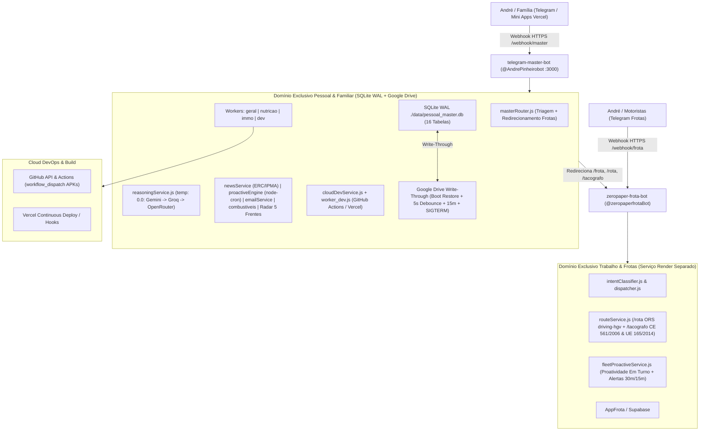

# Documento Mestre de Arquitetura e Operação do Sistema (100% Cloud-Native)

> **Documento Canónico — Arquitetura 100% Cloud-Native (Zero Dependência de PC Local)**  
> **Serviço Pessoal Nuvem 24/7 (`0h2h`):** [`https://telegram-master-bot-0h2h.onrender.com`](https://telegram-master-bot-0h2h.onrender.com) (`@AndrePinheirobot`, `POST /webhook/master`, `:3000`)  
> **Serviço Empresarial Nuvem 24/7 (Frota único):** [`https://zeropaper-frota-bot.onrender.com`](https://zeropaper-frota-bot.onrender.com) (`srv-dbqah556e07s73fj8550`, `@zeropaperfrotaBot`, repo `andre22pinheiro-ui/zeropaper-frota-bot`, `POST /webhook/frota`, `TELEGRAM_FROTAS_TOKEN`)  
> **Runtime:** Node.js ESM (`>=20.0.0`, Docker `node:20-alpine` no Render) | **Fuso Horário:** `Europe/Lisbon`

---

## 1. Visão Geral e Separação Estrita de Domínios

O ecossistema executa **100% na nuvem (Render + Vercel + GitHub Actions + Google Drive + Supabase)** com **separação absoluta entre vida pessoal/familiar e operações empresariais de frotas**:

### Regra de Isolamento de Domínios ([`AGENTS.md`](file:///c:/Users/Surface_Dpc/Desktop/projectos/telegram-master-bot/AGENTS.md))
1. **`telegram-master-bot` (`@AndrePinheirobot`):** Exclusivo para vida pessoal, família (André, esposa, bebé Carolina), nutrição & receitas saudáveis, notícias oficiais certificadas, casa/Amarante, farmácias, Radar 5 Frentes, email IMAP e DevOps Cloud (`/status_cloud`, `/compilar`, Vercel/GitHub). **Sem qualquer acesso a Supabase, `AppFrota` ou dados da `ZeroPaperFrota`, nem dependência de PC local.**
2. **Redirecionamento Automático de Frota ([`masterRouter.js`](file:///c:/Users/Surface_Dpc/Desktop/projectos/telegram-master-bot/src/router/masterRouter.js)):** Pedidos com `/frota`, `/frotas`, `/veiculos`, `/viaturas`, `/rota`, `/tacografo`, `/appfrota` ou menções a autocarros/viaturas/CE 561/2006 devolvem de imediato `FLEET_REDIRECT_MSG` apontando para **`@zeropaperfrotaBot`**.
3. **`zeropaper-frota-bot` (`@zeropaperfrotaBot`):** Serviço Web independente no Render ([`render.yaml`](file:///c:/Users/Surface_Dpc/Desktop/projectos/telegram-master-bot/render.yaml)), autenticado por `TELEGRAM_FROTAS_TOKEN` e servido em **`POST /webhook/frota`**, concentrando 100% da gestão de frota (Supabase AppFrota, KM, anomalias, higienizações, checklists, stock, `/rota` via ORS `driving-hgv` e `/tacografo` segundo o Regulamento CE n.º 561/2006).

---

## 2. Arquitetura Cloud-Native & Persistência Write-Through

1. **Boot Restore Obrigatório Antes do SQLite e HTTP:**
   - Em [`index.js`](file:///c:/Users/Surface_Dpc/Desktop/projectos/telegram-master-bot/index.js), `initCloudPersistence()` é aguardado **antes** de `sqliteMasterDb.getDb()` e `server.listen(PORT)`, restaurando `pessoal_master.db` e `autorizados.json` a partir do Google Drive e removendo ficheiros `-wal`/`-shm` residuais.
2. **Write-Through 5s + Sync Periódico 15m + Shutdown Gracioso:**
   - Todas as escritas críticas no [`sqliteMasterDb.js`](file:///c:/Users/Surface_Dpc/Desktop/projectos/telegram-master-bot/src/shared/sqliteMasterDb.js) disparam `triggerCloudSyncDebounced(5000)` em [`googleDriveService.js`](file:///c:/Users/Surface_Dpc/Desktop/projectos/telegram-master-bot/src/services/googleDriveService.js).
   - `startAutoDriveSync(15)` assegura backup periódico de 15 em 15 minutos com `wal_checkpoint(TRUNCATE)` prévio.
   - Handlers `SIGTERM` e `SIGINT` em [`index.js`](file:///c:/Users/Surface_Dpc/Desktop/projectos/telegram-master-bot/index.js) executam checkpoint SQLite e backup final para o Google Drive antes de encerrar o contentor Render.
3. **Webhooks Únicos Sem Conflito:**
   - Serviço Pessoal: `POST /webhook/master` (`TELEGRAM_BOT_TOKEN_MASTER`).
   - Serviço Frotas: `POST /webhook/frota` (`TELEGRAM_FROTAS_TOKEN`, com verificação opcional `TELEGRAM_WEBHOOK_SECRET`).
4. **Rotinas Autónomas Proativas ([`proactiveEngine.js`](file:///c:/Users/Surface_Dpc/Desktop/projectos/telegram-master-bot/src/services/proactiveEngine.js) via `node-cron` em `Europe/Lisbon`):**
   - **Janela de Silêncio Noturno (`22:30` – `07:30`):** Nenhuma notificação automática rotineira é enviada neste período; **apenas lembretes familiares críticos devidos** (`reminders`) contornam o silêncio.
   - **Keep-Alive Render & RAM (`*/10 * * * *`):** Ping HTTP a `${RENDER_EXTERNAL_URL}/health` + monitorização de memória RSS (`450MB` threshold) a cada **10 minutos**.
   - **08:00 (`Europe/Lisbon`):** Briefing Executivo Matinal Unificado ([`buildMorningExecutiveBriefing`](file:///c:/Users/Surface_Dpc/Desktop/projectos/telegram-master-bot/src/services/proactiveEngine.js)) — Notícias Certificadas + CM Amarante/CIM/A4-EN15/DRE + Previsão e Avisos IPMA Porto/Amarante (`1131200` / `PTO`) + Combustíveis DGEG Amarante/Lixa + Emails IMAP + Tarefas Pendentes.
   - **08:30 (`Europe/Lisbon`):** Relatório diário consolidado do Radar 5 Frentes ([`gerarRelatorioMultiFrenteMarkdown`](file:///c:/Users/Surface_Dpc/Desktop/projectos/telegram-master-bot/src/services/immoRadarService.js)).
   - **Ciclos de 4 em 4h (`08:05`, `12:05`, `16:05`, `20:05` `Europe/Lisbon`):** Varredura Multi-Frente + filtros `/vigiar` (`dispararCicloRadarComAlertas`), alertando exclusivamente em novidades ou descidas de preço reais.
   - **13:00 & 20:00 (`Europe/Lisbon`):** Check-in Proativo de Nutrição EFSA/ISSN (`evaluateNutritionProactiveCheck`); às `20:00`, se a proteína diária for `< 70%` (`< 112g` de `160g`), sugere receita rápida `/receita_mcc` ou `/receita_airfryer` com ervas aromáticas diretas e zero refogado.
   - **A cada 15 segundos:** Despacho imediato de lembretes críticos devidos (`dispatchDueReminders`, imune ao silêncio noturno).

5. **Conformidade Normativa Tripla Obrigatória (`temperature: 0.0`):**
   - **União Europeia:** EU AI Act (`Reg. UE 2024/1689` — transparência e zero alucinações), RGPD (`Reg. UE 2016/679` — mascaramento de logs via `maskEmailRgpd`/`maskPhoneRgpd` + HMAC-SHA256), Diretiva Omnibus (`Reg. UE 2019/2161` — validação de histórico de preço a 90 dias em `amazonRadarService.js` e `appleRadarService.js`), EFSA/ISSN (`160g` proteína, `2.5L` água, `5g` creatina), `Reg. (CE) n.º 561/2006` e `Reg. (UE) n.º 165/2014` (`4h30`, pausa `45m` ou `15m+30m`, `9h/10h`, `56h/90h` no serviço de frotas).
   - **República Portuguesa:** Código da Estrada (`DL 114/94`), `DL n.º 169/2009`, `Lei n.º 27/2010`, `Regulamento CMVM n.º 2/2015` + RGEU + Simplex Urbanístico (`DL n.º 10/2024`, desvalorização `-25%` sem licença), Direito do Consumo (`DL n.º 84/2021` — garantia legal de **3 anos** Apple/tech novo e auditoria de bateria/peças em Grau A `>=85%`), ERC/DRE/DGEG/IPMA.
   - **Município de Amarante & CIM Tâmega e Sousa:** PDM de Amarante & RMUE (`1.350 / 1.180 / 1.120 €/m²`; terreno `35 / 8 / 2 €/m²`), `cm-amarante.pt`, Proteção Civil e eixos `A4/Marão`, `EN15`, `EN210`.

---

## 3. Inteligência Artificial Determinística (`temperature: 0.0`) e Multimodal

1. **Regras Grok Bot ([`AGENTS.md`](file:///c:/Users/Surface_Dpc/Desktop/projectos/telegram-master-bot/AGENTS.md) & [`reasoningService.js`](file:///c:/Users/Surface_Dpc/Desktop/projectos/telegram-master-bot/src/services/reasoningService.js)):**
   - **Zero Alucinações & `temperature: 0.0`:** Todas as chamadas LLM (`askAgent` e `generateDeterministicCompletion`) e de visão (`multimodalVision.js`) usam `temperature: 0.0` (com `topP: 0.1` no Gemini).
   - **Cascata Canónica:**
     1. **Google Gemini:** `gemini-flash-latest` → `gemini-flash-lite-latest`
     2. **Groq LPU:** `process.env.GROQ_MODEL || 'qwen/qwen3.8-27b'` → `qwen/qwen3.8-27b` → `openai/gpt-oss-120b`
     3. **OpenRouter:** `openrouter/free` e modelos gratuitos de fallback
   - **Segurança de Credenciais:** Todas as chaves residem exclusivamente em variáveis de ambiente (`process.env.*`), sem segredos em código-fonte.
2. **Roteamento Cognitivo & Memória Conversacional:**
   - [`src/router/masterRouter.js`](file:///c:/Users/Surface_Dpc/Desktop/projectos/telegram-master-bot/src/router/masterRouter.js): `detectIntent` + `tryPersonalDispatch` (`temperature: 0.0`, JSON estruturado para compras, tarefas, diário Carolina, notas, lembretes, nutrição e DevOps Cloud) + `routeMessage`.
   - [`src/shared/conversationMemory.js`](file:///c:/Users/Surface_Dpc/Desktop/projectos/telegram-master-bot/src/shared/conversationMemory.js): persiste na tabela SQLite `conversation_history` com `MAX_TURNS = 12` e `SESSION_TTL_MS = 3h`.
3. **Multimodal (Visão & Voz) & Self-Refine:**
   - [`multimodalVision.js`](file:///c:/Users/Surface_Dpc/Desktop/projectos/telegram-master-bot/src/shared/multimodalVision.js) + [`cloudinaryCdn.js`](file:///c:/Users/Surface_Dpc/Desktop/projectos/telegram-master-bot/src/shared/cloudinaryCdn.js) + [`whisperAudio.js`](file:///c:/Users/Surface_Dpc/Desktop/projectos/telegram-master-bot/src/shared/whisperAudio.js).
   - [`selfRefineEngine.js`](file:///c:/Users/Surface_Dpc/Desktop/projectos/telegram-master-bot/src/shared/selfRefineEngine.js): persiste falhas na tabela SQLite `error_reports` e abre Pull Requests corretivos via GitHub Octokit.

---

## 4. Base de Dados Única SQLite WAL (`./data/pessoal_master.db`) — 16 Tabelas

Gerida por [`src/shared/sqliteMasterDb.js`](file:///c:/Users/Surface_Dpc/Desktop/projectos/telegram-master-bot/src/shared/sqliteMasterDb.js) (`MASTER_DB_PATH` sobreponível para testes; `journal_mode = WAL`; Write-Through 5s para o Google Drive):

| # | Tabela | Finalidade |
|---|---|---|
| 1 | `shopping` | Lista de compras partilhada (Telegram + Mini App) |
| 2 | `tasks` | Tarefas domésticas/familiares |
| 3 | `baby_logs` | Diário da bebé Carolina (faltas, saúde, escola, atividades) |
| 4 | `notes` | Notas rápidas com cor |
| 5 | `reminders` | Lembretes proativos em `Europe/Lisbon` |
| 6 | `nutrition_logs` | Proteína, calorias, hidratação e creatina diária |
| 7 | `saved_recipes` | Histórico de receitas saudáveis (Geral, Airfryer, MCC 4 blocos) |
| 8 | `radar_casas` | Frente 1: Moradias/imóveis Amarante + avaliação CMVM + historial de preço |
| 9 | `radar_carros` | Frente 2: Automóveis EV/PHEV/Combustão + baixas de preço |
| 10 | `radar_tech` | Frente 3: Tecnologia PT/ES + baixas de preço |
| 11 | `radar_amazon` | Frente 4: Amazon.es & Segunda Mano/Warehouse |
| 12 | `radar_apple` | Frente 5: Apple Novo 3A vs Recondicionado Grau A |
| 13 | `radar_filtros` | Filtros personalizados de vigilância (`/vigiar`, `/vigiar_amazon`, `/vigiar_apple`, `/meus_alertas`) |
| 14 | `radar_execucoes` | Registo de execuções e métricas dos ciclos multi-frente do Radar |
| 15 | `error_reports` | Registo estruturado de erros e autocorreções Self-Refine |
| 16 | `conversation_history` | Memória conversacional multi-turno (TTL 3h, máx. 12 turnos) |

---

## 5. Catálogo de Funcionalidades Cloud-Native (`@AndrePinheirobot`)

### 5.1 Notícias Certificadas ([`newsService.js`](file:///c:/Users/Surface_Dpc/Desktop/projectos/telegram-master-bot/src/services/newsService.js))
Whitelist estrita (`TRUSTED_SOURCES` verificada via `isTrustedSource(url)`):
`portugal.gov.pt`, `diariodarepublica.pt`, `ipma.pt`, `prociv.gov.pt`, `infraestruturasdeportugal.pt`, `ec.europa.eu`, `lusa.pt`, `rtp.pt`, `jn.pt`, `cm-amarante.pt`, `cimtamegaesousa.pt`, `averdade.com`, `tamegasousa.pt`, `expressodeamarante.pt`.
- `/noticias` — Briefing nacional, economia, Amarante, Governo e alertas IPMA/ANEPC.
- `/noticias_regiao` · `/amarante` — Atualidade do Tâmega e Sousa / Amarante.
- `/governo` · `/leis` — Comunicados `portugal.gov.pt`, Diário da República, IPMA/ANEPC/IP e Comissão Europeia.

### 5.2 Nutrição 160g & Receitas Saudáveis ([`worker_nutricao.js`](file:///c:/Users/Surface_Dpc/Desktop/projectos/telegram-master-bot/src/workers/worker_nutricao.js))
- Meta diária: **160g proteína**, **2500ml água**, **5g creatina**.
- `/plano` · `/hoje` · `/proteina <g> : <refeição>` · `/agua <ml>` · `/creatina`.
- `/receita [pedido]` · `/receita_airfryer [pedido]` · `/receita_mcc [pedido]` (Monsieur Cuisine Connect com regra anti-refogado): devolvem obrigatoriamente **4 blocos** (1. Tempo & Doses; 2. Ingredientes em gramas/ml; 3. Preparação passo a passo; 4. Tabela nutricional por dose incluindo `% da meta diária de 160g`) e gravam automaticamente em `saved_recipes`.

### 5.3 Radar de Oportunidades em 5 Frentes & Vigilância ([`worker_immo.js`](file:///c:/Users/Surface_Dpc/Desktop/projectos/telegram-master-bot/src/workers/worker_immo.js))
- **Frente 1 — Casas & CMVM ([`immoRadarService.js`](file:///c:/Users/Surface_Dpc/Desktop/projectos/telegram-master-bot/src/services/immoRadarService.js), [`immoCmvmService.js`](file:///c:/Users/Surface_Dpc/Desktop/projectos/telegram-master-bot/src/services/immoCmvmService.js)):** `/casas [zona]`, `/moradias_novas`, `/avaliacao <área> <zona> <tipologia> <estado> [terreno_m2] [CE]`, `/sites`.
- **Frente 2 — Carros ([`autoRadarService.js`](file:///c:/Users/Surface_Dpc/Desktop/projectos/telegram-master-bot/src/services/autoRadarService.js)):** `/carros [pesquisa]`.
- **Frente 3 — Tech PT/ES ([`techRadarService.js`](file:///c:/Users/Surface_Dpc/Desktop/projectos/telegram-master-bot/src/services/techRadarService.js)):** `/tech [produto]`.
- **Frente 4 — Amazon.es ([`amazonRadarService.js`](file:///c:/Users/Surface_Dpc/Desktop/projectos/telegram-master-bot/src/services/amazonRadarService.js)):** `/amazon [produto]`, `/ofertas`, `/vigiar_amazon <termo> [preço]`.
- **Frente 5 — Apple Novo vs Grau A ([`appleRadarService.js`](file:///c:/Users/Surface_Dpc/Desktop/projectos/telegram-master-bot/src/services/appleRadarService.js)):** `/apple [modelo]`, `/iphone_preco`, `/apple_refurb`, `/vigiar_apple <termo> [preço]`.
- **Vigilância Ativa & Relatórios:** `/vigiar <categoria> <termo|link> [preco_alvo]`, `/meus_alertas` (`apagar <id>`), `/radar`, `/relatorio`, `/alertas`.

### 5.4 Email IMAP, DGEG, Farmácias, Família, Lembretes, IPTV & Cloud DevOps
- **Email (`ImapFlow` + `mailparser`):** `/emails`, `/ler_email <N|assunto>`, `/email_status`, `/briefing`.
- **Utilidade Pública & Direito Pessoal:** `/combustiveis [concelho]`, `/gasoleo`, `/gasolina` (API DGEG), `/farmacias [concelho]`, `/transito`, `/pesquisa <termo>`, `/codigo_estrada`, `/sri` / `/cadeirinha` (Art. 55.º CE), `/dl84` (DL 84/2021 3 anos), `/mapa [pesquisa]` (`amaranteMapService.js` + `data/maps/amarante.osm`), `/ergonomia`.
- **Família, Agenda & Lembretes DST-safe:** `/compras`, `/tarefas`, `/carolina`, `/notas`, `/lembrete`, `/agenda` / `/evento` (`calendarHelperService.js` c/ exportação Google Calendar RGPD-safe).
- **IPTV & Streaming:** `/tv [canal]`, `/canal`, `/portugal.m3u`.
- **DevOps 100% Cloud ([`cloudDevService.js`](file:///c:/Users/Surface_Dpc/Desktop/projectos/telegram-master-bot/src/services/cloudDevService.js) + [`worker_dev.js`](file:///c:/Users/Surface_Dpc/Desktop/projectos/telegram-master-bot/src/workers/worker_dev.js)):** `/status_cloud`, `/compilar <repo> [workflow] [branch]` (GitHub Actions `workflow_dispatch`), `/projetos`, `/criar_app`, `/apps` (API live Vercel), `/apks`, `/pladur [m2]` (`pladurService.js` EN 520 / EN 14195), `/erros` & `/self_refine` (`selfRefineEngine.js` integrado no `safeExecute` e webhooks).
- **Administração & Drive:** `/autorizados`, `/autorizar`, `/bloquear`, `/drive`, `/diagnostico`, `/status`.

---

## 6. Mini Apps Web (`appsCatalog.js`) e Endpoints HTTP (`index.js`)

### 6.1 Segregação das 9 Mini Apps Vercel ([`src/shared/appsCatalog.js`](file:///c:/Users/Surface_Dpc/Desktop/projectos/telegram-master-bot/src/shared/appsCatalog.js))

| Domínio | Aplicação | URL Oficial |
| :--- | :--- | :--- |
| `pessoal` | **Família (Gestão & Carolina)** | `https://gestao-familiar-webapp.vercel.app` |
| `pessoal` | **ImmoEval (Avaliação Imobiliária)** | `https://pesquisa-imobiliario.vercel.app` |
| `pessoal` | **Pladur-Pro (Engenharia 3D)** | `https://pladur-pro.vercel.app` |
| `pessoal` | **Casa de Bonecas 3D** | `https://casadebonecas-3d.vercel.app` |
| `pessoal` | **MatchPro (Tática & Jogos)** | `https://matchpro-alpha.vercel.app` |
| `pessoal` | **Last War Tactics** | `https://last-war-tactics.vercel.app` |
| `pessoal` | **Scaffold Bot Preview** | `https://teste-scaffold-bot.vercel.app` |
| `trabalho` | **AppFrota** *(encaminhado para `@zeropaperfrotaBot`)* | `https://appfrota-ten.vercel.app` |
| `trabalho` | **RotaBus** *(encaminhado para `@zeropaperfrotaBot`)* | `https://smooth-bus-routes.vercel.app` |

### 6.2 Endpoints HTTP Pessoais (`PORT=3000`, zero `/api/sync/*`)
- **Webhook Principal:** `POST /webhook/master` (`@AndrePinheirobot`)
- **Pontes Legacy Cloud-Native ([`src/bot/legacyBridges.js`](file:///c:/Users/Surface_Dpc/Desktop/projectos/telegram-master-bot/src/bot/legacyBridges.js)):** `POST /webhook/dev` (`@DesSofBot`), `POST /webhook/immo` (`@ppspppBot`), `POST /webhook/pessoal` (`@AndTrarBOT`), `POST /webhook/nutricao` (`@Nutriainbot`) encaminhados para os workers unificados SQLite+IA, e `POST /webhook/frotas` (`@TrasFrotBot`) em redirecionamento estrito para **`@zeropaperfrotaBot`**.
- **Estado & Catálogo:** `GET /`, `GET /health`, `GET /webapp`, `GET /api/apps`, `GET /portugal.m3u`
- **API Familiar SQLite WAL ([`familyRoutes.js`](file:///c:/Users/Surface_Dpc/Desktop/projectos/telegram-master-bot/src/shared/familyRoutes.js)):** `/api/family/shopping`, `/api/family/tasks`, `/api/family/baby`, `/api/family/notes`

---

## 7. Serviço Isolado de Trabalho (`zeropaper-frota-bot`)

Localizado em [`c:/Users/Surface_Dpc/Desktop/projectos/zeropaper-frota-bot`](file:///c:/Users/Surface_Dpc/Desktop/projectos/zeropaper-frota-bot) (`@zeropaperfrotaBot`, serviço único em **`https://zeropaper-frota-bot.onrender.com`** e declarado exclusivamente no seu próprio `render.yaml` — ficando `zeropaper-frota-bot-0h2h` desacoplado para reaproveitamento pessoal):
- Endpoint dedicado **`POST /webhook/frota`** autenticado por **`TELEGRAM_FROTAS_TOKEN`** (`fleetWebhookTransport.js` com `getWebhookInfo`, backoff 429 e zero polling em nuvem) e `TELEGRAM_WEBHOOK_SECRET` opcional.
- Persistência operacional isolada no **Supabase** (`AppFrota`), confirmação em 2 passos, idempotência SHA-256 e matriz RBAC por perfil.
- [`src/services/routeService.js`](file:///c:/Users/Surface_Dpc/Desktop/projectos/zeropaper-frota-bot/src/services/routeService.js) + [`amaranteHeavyMapService.js`](file:///c:/Users/Surface_Dpc/Desktop/projectos/zeropaper-frota-bot/src/services/amaranteHeavyMapService.js): `/rota` (ORS `driving-hgv` + contexto OSM Amarante sem restrições inventadas) e `/tacografo` (CE 561/2006 & UE 165/2014 integrado com `evaluateDrivingLimitAlert`).
- [`src/services/fleetComplianceService.js`](file:///c:/Users/Surface_Dpc/Desktop/projectos/zeropaper-frota-bot/src/services/fleetComplianceService.js): módulos `/tcc` (`UFCD-TCC-01..03`, Lei 13/2006, Smart Tacho Gen 2), `/gsr2` (Reg. UE 2019/2144 ADAS/BSIS/MOIS/EDR) e `/leis` pesados / DRE.
- [`src/services/fleetProactiveService.js`](file:///c:/Users/Surface_Dpc/Desktop/projectos/zeropaper-frota-bot/src/services/fleetProactiveService.js): proatividade em turno — avisos preventivos 30 min e 15 min antes das 4h30 (`evaluateDrivingLimitAlert`), alerta matinal `07:30` / botão cockpit `btn_shift_anomalies` de anomalias abertas em Supabase (`buildShiftStartAnomalyAlert`) e fecho `19:30`.

---

## 8. Segurança, Blueprints Render e Testes

- **Controlo de Acesso ([`security.js`](file:///c:/Users/Surface_Dpc/Desktop/projectos/telegram-master-bot/src/shared/security.js)):** Dual Whitelist (`919115655`, `933276221`) + `CHAT_ID_AUTORIZADO` + `CHAT_ID_ESPOSA` opcional em `./data/autorizados.json`; validação WebApp HMAC-SHA256 ([`telegramAuth.js`](file:///c:/Users/Surface_Dpc/Desktop/projectos/telegram-master-bot/src/shared/telegramAuth.js)).
- **Render Blueprint Unificado ([`render.yaml`](file:///c:/Users/Surface_Dpc/Desktop/projectos/telegram-master-bot/render.yaml)):** Declara explicitamente os dois serviços web (`telegram-master-bot` pessoal SQLite+Drive vs. `zeropaper-frota-bot` trabalho Supabase+ORS).
- **Suites de Teste Oficiais:**
  - `npm test` em `telegram-master-bot`: [`tests/run_master_battery.mjs`](file:///c:/Users/Surface_Dpc/Desktop/projectos/telegram-master-bot/tests/run_master_battery.mjs)
  - `npm run test:live` em `telegram-master-bot`: [`tests/test_all_bots_maximum_response.mjs`](file:///c:/Users/Surface_Dpc/Desktop/projectos/telegram-master-bot/tests/test_all_bots_maximum_response.mjs)
  - `npm test` em `zeropaper-frota-bot`: `node --test tests/**/*.test.js`
